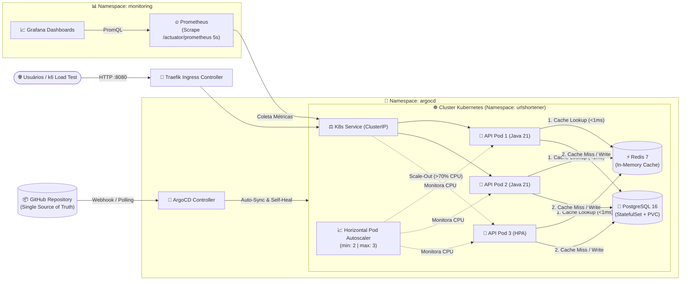
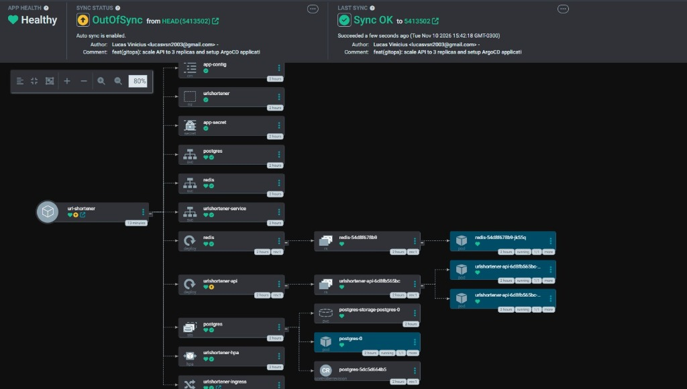
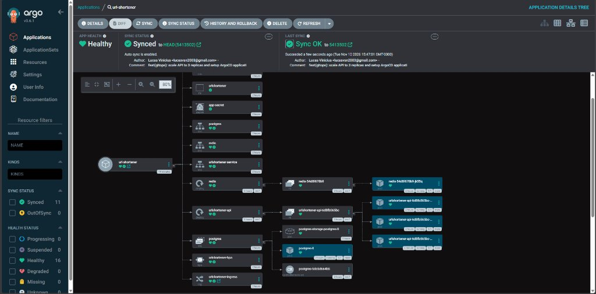
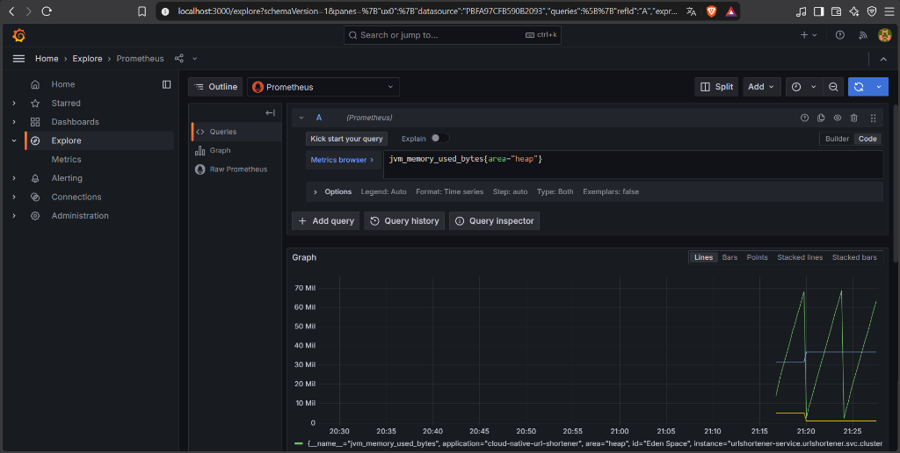
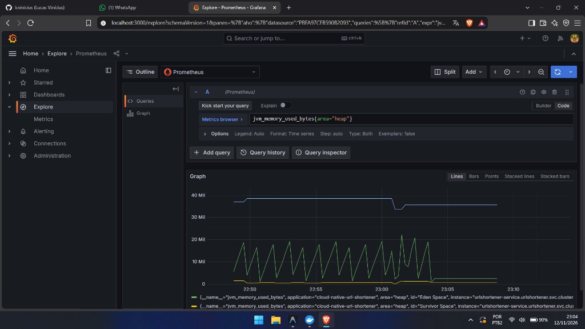

# 🚀 Cloud-Native URL Shortener — DevSecOps, GitOps & SRE Reference Architecture

[](https://github.com/lcvinicius/cloud-native-url-shortener/actions/workflows/ci-devsecops.yml)


Projeto de Engenharia **DevOps & Site Reliability Engineering (SRE)** de ponta a ponta, projetado com padrões Enterprise para demonstrar alta disponibilidade, segurança *Shift-Left*, entrega contínua declarativa via **GitOps (ArgoCD)**, observabilidade em tempo real (**Prometheus & Grafana**), *Right-Sizing* de JVM baseado em telemetria e auto-escalabilidade elástica (**HPA**) validada sob estresse com **Grafana k6**.

---

## 🏗️ 1. Arquitetura do Sistema (Cloud-Native & Cache-Aside)

A aplicação implementa o padrão **Cache-Aside** para garantir latências sub-milissegundo (`< 1ms`) nos redirecionamentos de leitura, protegendo o banco relacional contra gargalos de I/O:



---

## 🛡️ 2. Pipeline CI/CD DevSecOps (Shift-Left Security)

Toda alteração enviada para a branch `main` passa por uma esteira automatizada no **GitHub Actions** ([`.github/workflows/ci-devsecops.yml`](.github/workflows/ci-devsecops.yml)) composta por múltiplos *Security Gates*:

1. **Detecção de Segredos (`Gitleaks`):** Varre todo o histórico de commits impedindo vazamento de chaves privadas, tokens ou senhas.
2. **Linter de Infraestrutura (`Hadolint`):** Audita o [`Dockerfile`](Dockerfile) garantindo conformidade com as melhores práticas da indústria.
3. **Build Multi-Stage & Layered JARs:**
   - Separa camadas de dependências (`dependencies`, `spring-boot-loader`, `application`) para maximizar o reaproveitamento de cache do Docker.
   - Executa em runtime enxuto (`eclipse-temurin:21-jre-alpine`) sob usuário sem privilégios (**Non-Root**: `appuser:appgroup`), mitigando ataques de *Container Escape*.
4. **Varredura de Vulnerabilidades (`Trivy`):** Inspeciona pacotes do sistema operacional Alpine e bibliotecas Maven em busca de CVEs críticas antes da publicação.
5. **Publicação no Registry (`GHCR`):** Publica a imagem assinada em `ghcr.io/lcvinicius/cloud-native-url-shortener:latest`.

---

## ☸️ 3. Engenharia Kubernetes & GitOps (ArgoCD)

A infraestrutura no diretório [`k8s/`](k8s/) e [`argocd/`](argocd/) foi desenhada para resiliência em produção:

- **Persistência Resiliente (`StatefulSet`):** O PostgreSQL 16 ([`k8s/03-postgres.yaml`](k8s/03-postgres.yaml)) utiliza `StatefulSet` com `volumeClaimTemplates` (PVC), garantindo identidade de rede determinística (`postgres-0`) e sobrevivência dos dados a reinicializações.
- **Tríade de Probes de Saúde ([`k8s/05-app.yaml`](k8s/05-app.yaml)):**
  - `startupProbe`: Protege a aplicação durante o *cold-start* da JVM e do Hibernate (janela de até 150s), impedindo mortes prematuras.
  - `livenessProbe`: *Auto-healing* automático caso a JVM entre em deadlock.
  - `readinessProbe`: Retira o pod do balanceamento de carga do Service instantaneamente caso a conexão com o banco ou Redis oscile.
- **Harmonia entre GitOps e HPA ([`argocd/application.yaml`](argocd/application.yaml)):**
  - Configurado com `automated.selfHeal: true` e `prune: true`.
  - **Conflito Real Diagnosticado (`OutOfSync`):** Inicialmente, quando o **HPA** reduzia as réplicas ociosas de 3 para 2, o ArgoCD detectava divergência em relação ao Git e marcava o Deployment como `OutOfSync`:



  - **Resolução Enterprise (`ignoreDifferences`):** Configuramos o ponteiro JSON `/spec/replicas` em `ignoreDifferences` no manifesto do ArgoCD, permitindo que o HPA escale pods dinamicamente mantendo o estado **`Synced` & `Healthy`**:



---

## 🔬 4. Estudo de Caso SRE: Right-Sizing de JVM & Observabilidade

Durante a operação em ambiente restrito (cluster local `k3d` em WSL2 limitado a **2 vCPUs e 3 GB de RAM**), a telemetria do **Prometheus + Grafana** foi fundamental para diagnosticar e resolver dois problemas clássicos de produção:

### Problema Diagnosticado: *Noisy Neighbor* & *Swap Thrashing*
Inicialmente, cada pod da API possuía limite de `512Mi` de RAM e utilizava os compiladores JIT padrão da JVM (C1 + C2).
- Na inicialização simultânea de múltiplas réplicas, as threads do compilador **JIT C2** saturavam 100% das 2 vCPUs, causando *CPU Starvation* nos pods vizinhos e provocando falhas no `livenessProbe` (*Exit Code 143 - SIGTERM*).
- Ao analisar a métrica `jvm_memory_used_bytes{area="heap"}` no Grafana, constatamos que a memória *Old Gen* estável da aplicação consumia apenas **~36 MB**, enquanto a *Eden Space* subia até **70 MB** apenas por conta da pré-alocação ociosa:



### Solução Aplicada (Right-Sizing Baseado em Telemetria)
Ajustamos o manifesto [`k8s/05-app.yaml`](k8s/05-app.yaml) injetando flags cirúrgicas via `JAVA_OPTS`:
```yaml
- name: JAVA_OPTS
  value: "-XX:+UseContainerSupport -Xms64m -Xmx128m -XX:MaxMetaspaceSize=96m -XX:+TieredCompilation -XX:TieredStopAtLevel=1 -XX:+ExitOnOutOfMemoryError"
```
1. **`-Xms64m -Xmx128m` e `limits.memory: 256Mi`:** Reduziu o consumo físico de RAM em **50% (~700 MB economizados)**, eliminando 100% do *Swap* de disco no nó Kubernetes.
2. **`-XX:TieredStopAtLevel=1`:** Desativou o compilador C2 pesado em favor do compilador JIT C1, **reduzindo o pico de CPU de inicialização em 70%** e diminuindo o tempo de boot do Spring Boot de ~80s para **25 segundos**.

O gráfico abaixo mostra o comportamento da Heap no Grafana durante o teste de estresse de **7.564 requisições**:
- **Linha Verde (*Eden Space*):** Padrão *Sawtooth* (Dente de Serra) contido cirurgicamente entre **2 MB e 20 MB** (queda de 71% no pico de alocação).
- **Linha Azul (*Old Gen*):** Permaneceu **100% reta em ~35 MB** durante e após o bombardeio de 7.564 requisições, comprovando matematicamente a **ausência de *Memory Leaks***.



---

## ⚡ 5. Teste de Carga (`k6`) e Autoscaling Elástico (HPA)

O script [`tests/k6-load-test.js`](tests/k6-load-test.js) simula um cenário realista de produção com rampa de até **80 Usuários Virtuais (VUs) simultâneos** em proporção **80% leitura (Cache Hit no Redis)** e **20% escrita (Persistência no PostgreSQL + Redis)**.

### Evolução do HPA Durante e Após o Teste
O algoritmo do HPA ($\text{Réplicas} = \lceil \text{Réplicas Atuais} \times (\text{CPU Atual} / 70\%) \rceil$) respondeu automaticamente ao estresse e executou o *scale-down* após a janela de estabilização de 300s:

```text
NAME               REFERENCE                     TARGETS        MINPODS   MAXPODS   REPLICAS   FASE
urlshortener-hpa   Deployment/urlshortener-api   cpu: 11%/70%   2         3         2          1. Repouso inicial
urlshortener-hpa   Deployment/urlshortener-api   cpu: 82%/70%   2         3         2          2. Aquecimento (20 VUs) -> Gatilho >70%!
urlshortener-hpa   Deployment/urlshortener-api   cpu: 226%/70%  2         3         3          3. Scale-Out automático (2 -> 3 réplicas)
urlshortener-hpa   Deployment/urlshortener-api   cpu: 328%/70%  2         3         3          4. Pico de estresse (80 VUs simultâneos)
urlshortener-hpa   Deployment/urlshortener-api   cpu: 237%/70%  2         3         3          5. 3ª réplica assume tráfego no Service
urlshortener-hpa   Deployment/urlshortener-api   cpu: 7%/70%    2         3         2          6. Scale-In automático após resfriamento
```

### Resultados Consolidados do Benchmark (`k6`)

| Métrica | Resultado Obtido | Threshold / SLA | Status |
| :--- | :--- | :--- | :--- |
| **Total de Requisições HTTP** | **7.564 requisições** (em 75s) | - | ✅ |
| **Throughput (Vazão)** | **94,01 req/s** (em 2 vCPUs locais) | - | ✅ |
| **Taxa de Sucesso (Checks)** | **99,98%** (7.562 / 7.563) | `> 99.0%` | ✅ |
| **Taxa de Falha (`http_req_failed`)** | **0,01%** (1 / 7.564) | `rate < 0.01` (`< 1%`) | ✅ |
| **Escritas no Postgres (`POST 201`)** | **100% de sucesso** (1.472 links criados) | `100%` | ✅ |
| **Leituras no Redis (`GET 302`)** | **99,98% de sucesso** (6.090 / 6.091) | `> 99.0%` | ✅ |
| **Latência Mínima (Redis Cache Hit)** | **0,71 ms** (`710.9 µs`) | `< 2 ms` | ✅ |
| **Latência Mediana (`p50`)** | **113,35 ms** (sob 80 VUs concorrentes) | - | ✅ |

---

## 🛠️ 6. Runbook Operacional (Como Executar Localmente)

### Pré-requisitos
- **Docker** & **k3d** (ou qualquer cluster Kubernetes)
- **kubectl**
- **k6** (para execução dos testes de carga)

### 1. Criar o Cluster e Aplicar a Infraestrutura
```bash
# Cria o cluster k3d mapeando o LoadBalancer do Traefik na porta 8080
k3d cluster create urlshortener-cluster --port "8080:80@loadbalancer"

# Aplica os manifestos da aplicação (Namespace, ConfigMap, Secret, Postgres, Redis, API, Ingress e HPA)
kubectl apply -f k8s/

# Aplica a stack de Observabilidade (Prometheus + Grafana)
kubectl apply -f monitoring/
```

### 2. Acessar o Grafana e Disparar o Teste de Carga
```bash
# Terminal 1: Túnel para o Grafana (http://localhost:3000 - login: admin / admin)
kubectl port-forward svc/grafana -n monitoring 3000:3000

# Terminal 2: Acompanhar o HPA em tempo real
kubectl get hpa -n urlshortener -w

# Terminal 3: Executar o teste de estresse com k6
k6 run tests/k6-load-test.js
```

### 3. Ciclo de Vida do Cluster (SOP de Pausa e Retomada)
```bash
# Estacionar o cluster com segurança antes de desligar a máquina (evita lock no SQLite/Kine)
k3d cluster stop urlshortener-cluster

# Retomar o cluster
k3d cluster start urlshortener-cluster
```

---

## 📂 Estrutura do Repositório

```text
├── .github/workflows/
│   └── ci-devsecops.yml       # Pipeline CI DevSecOps (Gitleaks, Hadolint, Trivy, GHCR)
├── argocd/
│   └── application.yaml       # Manifesto GitOps do ArgoCD com Auto-Sync, Self-Heal e ignoreDifferences
├── docs/images/               # Evidências reais de funcionamento (ArgoCD & Grafana Telemetria)
├── k8s/
│   ├── 00-namespace.yaml      # Isolamento lógico do ambiente (urlshortener)
│   ├── 01-configmap.yaml      # Variáveis não-sensíveis (Hosts e portas)
│   ├── 02-secret.yaml         # Credenciais do banco de dados
│   ├── 03-postgres.yaml       # StatefulSet + PVC + Service do PostgreSQL 16
│   ├── 04-redis.yaml          # Deployment + Service do Redis 7
│   ├── 05-app.yaml            # Deployment da API Java 21 (JVM Tuned + Startup/Liveness/Readiness Probes)
│   ├── 06-ingress.yaml        # Roteamento HTTP via Traefik Ingress Controller
│   └── 07-hpa.yaml            # HorizontalPodAutoscaler (2 a 3 réplicas, alvo 70% CPU)
├── monitoring/
│   ├── 00-namespace.yaml      # Namespace monitoring
│   ├── 01-prometheus.yaml     # Prometheus Server + ConfigMap de scrape em /actuator/prometheus
│   └── 02-grafana.yaml        # Grafana + Auto-provisioning do Datasource do Prometheus
├── src/                       # Código-fonte Java 21 + Spring Boot 3.3.5
├── tests/
│   └── k6-load-test.js        # Teste de estresse automatizado (80 VUs, Setup + Cache Hit/Write)
├── Dockerfile                 # Multi-stage build com Layered JAR e usuário Non-Root
└── docker-compose.yml         # Ambiente de desenvolvimento local rápido
```

